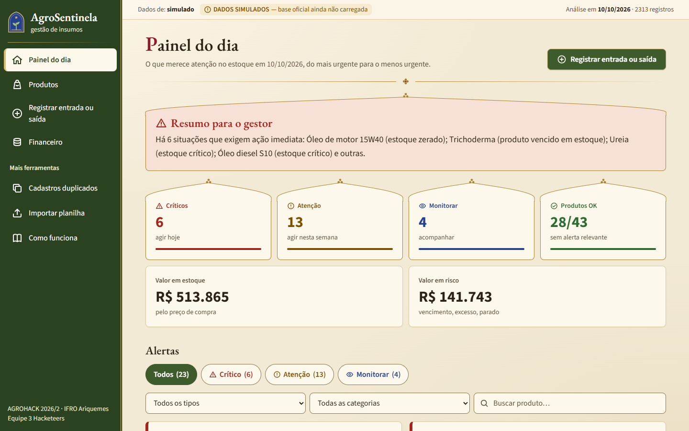
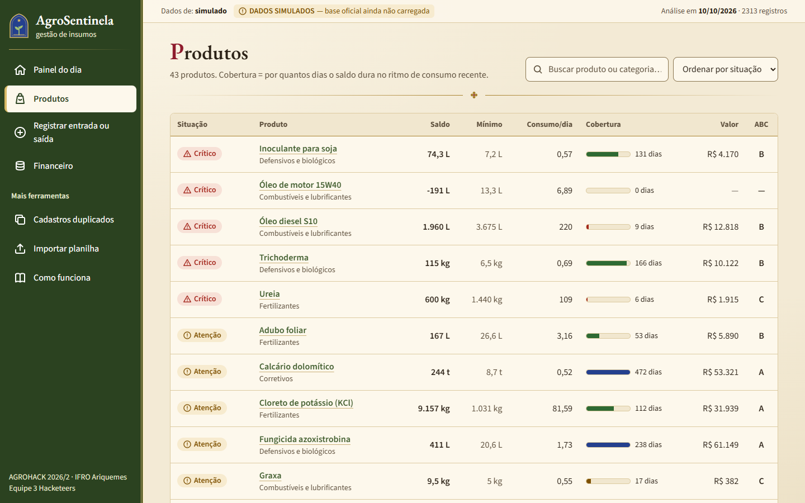
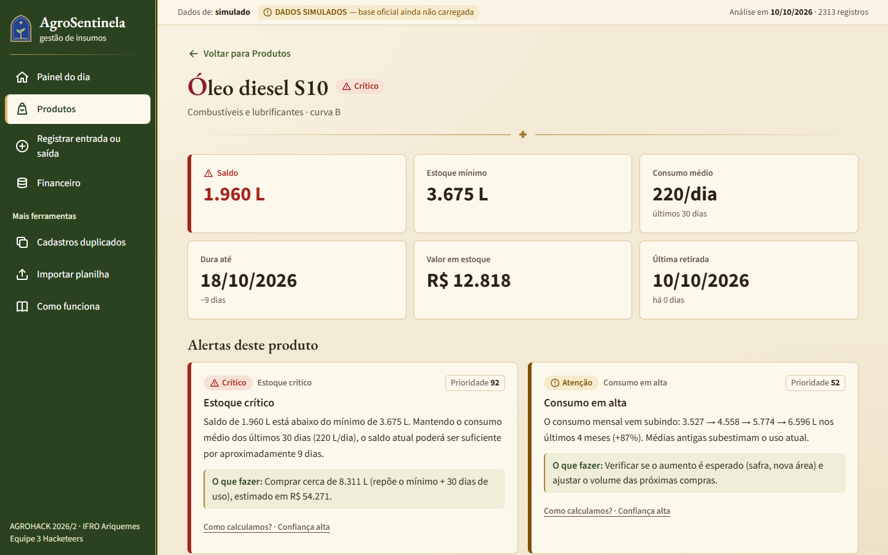
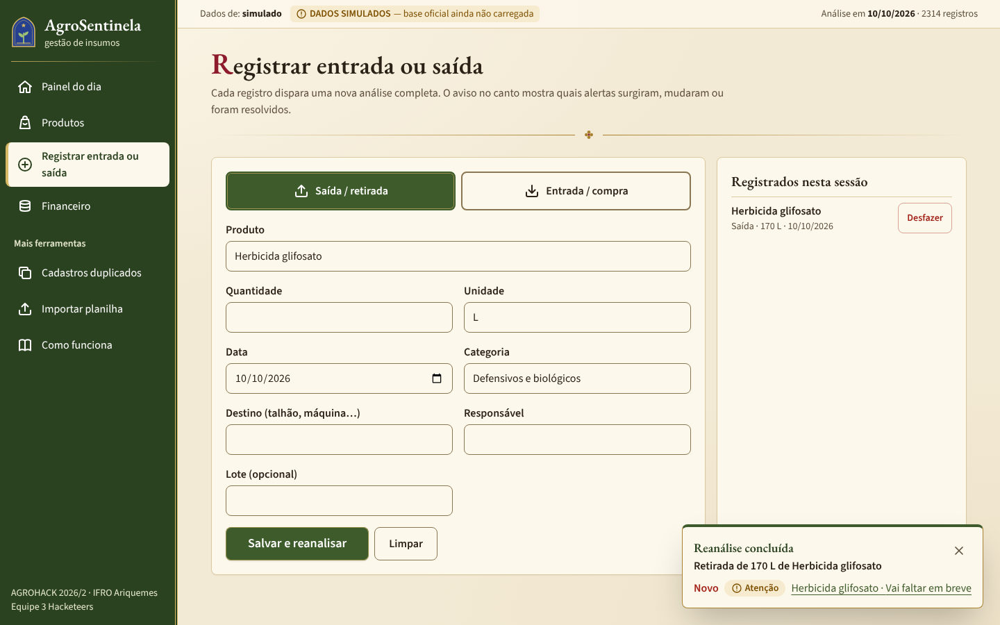
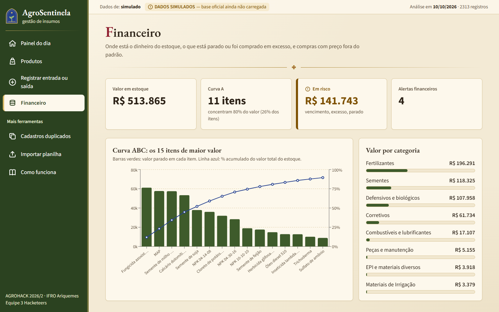
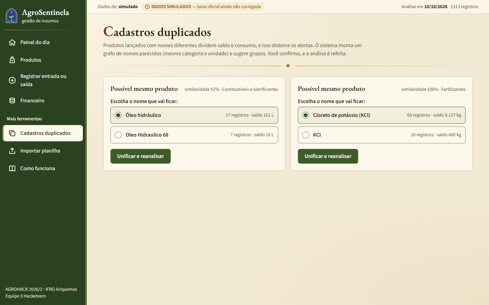
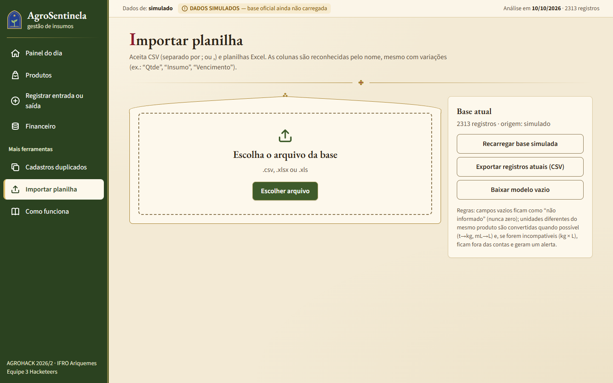
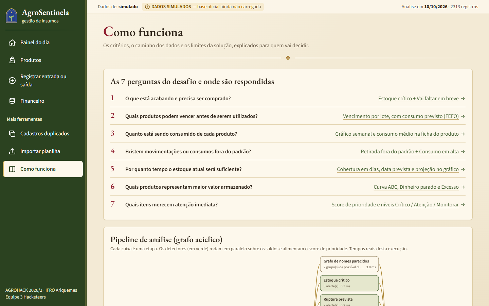
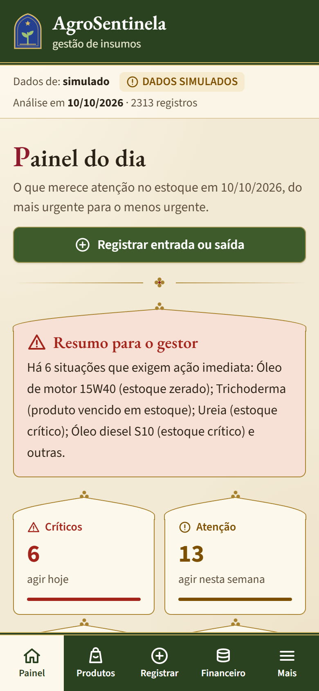
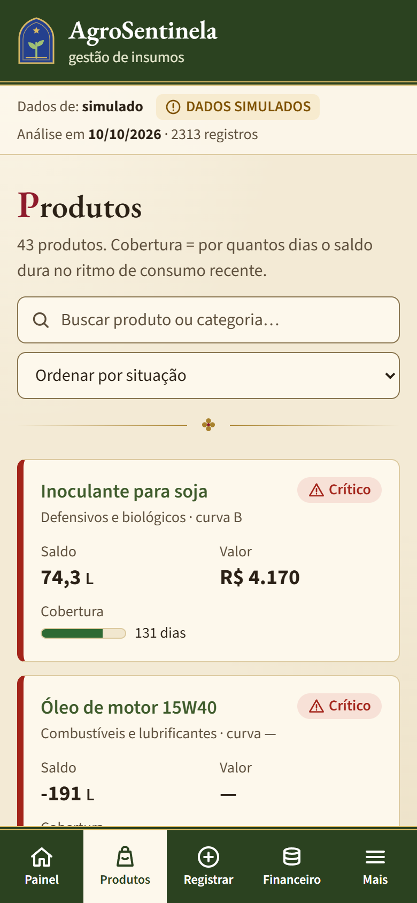

# AgroSentinela: gestão inteligente de insumos rurais

> **AGROHACK 2026/2 · IFRO Campus Ariquemes** · Desafio oficial: *Gestão inteligente de insumos em uma propriedade rural*
>
> A AgroSentinela transforma os registros de entradas e saídas do estoque em **alertas priorizados e justificados**. Cada alerta diz **o quê** está acontecendo, **por quê**, **o que fazer** e **quanto dá para confiar** na estimativa.

**Link da solução:** [agrohack-agrosentinela.netlify.app](https://agrohack-agrosentinela.netlify.app) (slides do pitch em [`/pitch`](https://agrohack-agrosentinela.netlify.app/pitch))\
**Vídeo demonstrativo:** [youtu.be/t3ghbFW5BiI](https://youtu.be/t3ghbFW5BiI)\
**Versão avaliada:** tag `v1.0-entrega`

---

## 1. Equipe: 3 Hacketeers

| Integrante | Curso | Função |
|---|---|---|
| Armando Giordani Trassi (**responsável**) | ADS, 6º período | Produto, validação com usuários e pitch |
| Pedro Felipe Vieira Gouveia | ADS, 6º período | Motor de análise e loop de avaliação |
| Leandro Pires de Moraes Filho | ADS, 6º período | Interface, deploy e vídeo |

## 2. Problema e público

**Público:** o responsável pelo almoxarifado ou pela gestão de uma propriedade rural (nossa persona é o "Seu João", gerente da fazenda). Ele registra compras e retiradas, mas não tem tempo de cruzar centenas de lançamentos.

**Problema:** saber o saldo não basta. Faltas inesperadas param a operação (diesel no plantio, por exemplo), produtos vencem parados, compras em excesso imobilizam dinheiro e erros de cadastro escondem tudo isso.

**Decisões que a solução apoia:**
- o que comprar agora;
- o que usar primeiro;
- o que não comprar de novo;
- qual retirada conferir;
- qual cadastro corrigir.

## 3. Solução

| Tela | Para quê |
|---|---|
| **Painel do dia** | Alertas ordenados por prioridade (Crítico, Atenção, Monitorar), resumo para o gestor, filtros |
| **Produtos** | Saldo, mínimo, consumo/dia, cobertura em dias, valor e curva ABC de cada item |
| **Ficha do produto** | Gráfico do saldo com **projeção** e **previsão do modelo com faixa de incerteza**, consumo semanal, lotes por validade (FEFO), histórico |
| **Registrar entrada ou saída** | Nova entrada ou saída, com **reanálise imediata** e aviso do que mudou (alertas novos, resolvidos ou que mudaram de nível) |
| **Financeiro** | Curva ABC (Pareto), valor por categoria, dinheiro parado, excesso, variação de preço |
| **Cadastros duplicados** | Grupos de nomes parecidos (grafo de similaridade); unificar com um clique e a análise é refeita |
| **Importar planilha** | CSV ou Excel com **mapeamento automático de colunas** e relatório de linhas rejeitadas |
| **Como funciona** | As 7 perguntas do edital, o pipeline (DAG) com tempos reais, critérios e limites |

### Telas

| | |
|---|---|
|  |  |
| **Painel do dia** — resumo para o gestor, alertas por nível e o botão para registrar logo no topo. | **Produtos** — saldo, mínimo, consumo por dia, cobertura em dias e curva ABC de cada item. |
|  |  |
| **Ficha do produto** — quanto tem, quanto gasta, até quando dura e o que fazer. | **Registrar entrada ou saída** — ao salvar, o aviso no canto mostra os alertas que surgiram. |
|  |  |
| **Financeiro** — curva ABC, valor por categoria e dinheiro em risco. | **Cadastros duplicados** — nomes parecidos agrupados; unificar refaz a análise. |
|  |  |
| **Importar planilha** — CSV ou Excel, com as colunas reconhecidas pelo nome. | **Como funciona** — as 7 perguntas do desafio, o pipeline e os critérios. |
|  |  |
| **Celular** — menu fixo no rodapé, botões grandes e textos legíveis. | **Celular** — a tabela de produtos vira uma lista de cards. |

Capturas de 23/10/2026 com a base **SIMULADA**, em 1440×900 (computador) e 390×844 (celular). A tela de registro mostra a retirada de 170 L de glifosato da demonstração (seção 6). Para gerar de novo: `npm run build && npm start` e, em outro terminal, `npm run capturar-telas` (requer o Microsoft Edge).

### Os 10 detectores

1. Estoque crítico
2. Vai faltar em breve
3. Consumo em alta
4. Retirada fora do padrão
5. Risco de vencimento (por lote, com consumo previsto)
6. Excesso de estoque
7. Variação de preço
8. Dinheiro parado (curva ABC)
9. Cadastro duplicado
10. Qualidade dos dados

Os critérios completos estão em [`docs/criterios-alertas.md`](docs/criterios-alertas.md).

Exemplo real de saída:

> **Estoque crítico:** saldo de 1.960 L está abaixo do mínimo de 3.675 L. Mantendo o consumo médio dos últimos 30 dias (220 L/dia), o saldo atual poderá ser suficiente por aproximadamente 9 dias.
> **O que fazer:** comprar cerca de 8.311 L. *Confiança alta: 15 retiradas na janela e 376 dias de histórico.*

## 4. Como testar

Requisitos: Node.js 20+.

```bash
npm install
npm run dev          # http://localhost:3000 (abre com a base SIMULADA)
npm test             # 26 testes unitários (Vitest)
npm run eval         # loop de avaliação → docs/eval-report.md
npm run eval:robustez # avaliação em 10 bases simuladas diferentes
npm run eval:previsao # backtest do modelo de previsão → docs/eval-previsao.md
npm run gerar-dados  # recria data/simulado.csv e o gabarito
npm run build && npm start
```

**Base oficial:** quando for divulgada, use *Importar planilha* e envie o arquivo (CSV ou XLSX). As colunas são reconhecidas pelo nome.

**Persistência:**
- Por padrão, os dados ficam no navegador.
- Para usar o banco, crie um projeto Supabase e rode `supabase/migrations/20261014000000_inicial.sql`.
- Depois, preencha `.env.local` a partir de `.env.example`, **somente com a chave pública (anon)**.

## 5. Dados e critérios

- **Campos usados:** produto, categoria, unidade, quantidade, estoque mínimo, tipo, data, preço de aquisição, lote, validade, fornecedor, destino da retirada e responsável. São os mesmos da seção 3 do desafio.
- **Tratamentos:**
  - números em formato brasileiro, datas em vários formatos e serial do Excel;
  - grafias unificadas (acento e maiúsculas);
  - conversão de unidades da mesma família (t→kg, mL→L);
  - **unidades incompatíveis não são somadas**;
  - **preço ou validade ausentes não viram zero**.
- **Data de referência:** é a data mais recente dos registros, e pode ser alterada em *Como funciona*.
- **Critérios, limiares e limites das estimativas:** ver [`docs/criterios-alertas.md`](docs/criterios-alertas.md).
- **Base simulada:** `data/simulado.csv` é **SIMULADA** (coluna `simulado=true`, aviso fixo no topo do app). Ela só existe para desenvolver e testar até a base oficial ser divulgada. O gabarito das anomalias plantadas está em `data/ground_truth.json`.

### O que é real e o que é simulado na demonstração

- **Real:** o motor de análise, os 10 detectores, a prioridade, a reanálise e a importação. Tudo roda de verdade no navegador, sobre qualquer base importada.
- **Simulado:** a base usada até a divulgação da oficial. Os produtos e o comportamento de consumo imitam uma propriedade da região, com soja, milho, café e horta, mas as situações problemáticas foram **plantadas por nós** para medir se cada regra funciona. Os nomes de responsáveis são fictícios.
- **Quando a base oficial sair:** ela substitui a simulada na demonstração (tela *Importar planilha*), e a revisão manual dos alertas fica registrada em [`docs/validacao.md`](docs/validacao.md).

## 6. Demonstração

- **Vídeo:** [youtu.be/t3ghbFW5BiI](https://youtu.be/t3ghbFW5BiI) (3 min, narrado e legendado). O roteiro está em [`docs/roteiro-video.md`](docs/roteiro-video.md).
- **Atualização e reanálise:** em *Registrar entrada ou saída*, registre uma retirada de **170 L** de "Herbicida glifosato" na data sugerida (a data de referência da base simulada). Ao salvar, o aviso no canto mostra só "Novo · Atenção · Herbicida glifosato · Vai faltar em breve". O teste `tests/demo.test.ts` garante esse resultado. Com a base simulada, o aviso é o mesmo para retiradas de 120 a 225 L; a partir de 230 L o nível passa a Crítico, e retiradas muito grandes também geram "Estoque crítico" e "Retirada fora do padrão".
- **Unificação:** em *Cadastros duplicados*, unifique "KCl" com "Cloreto de potássio (KCl)". O alerta falso de ruptura do "KCl" é resolvido na hora.

## 7. Validação

O plano de teste completo, com o oráculo de cada parte e os casos de caminho feliz e de erro, está em [`TESTING.md`](TESTING.md). Separamos quatro perguntas diferentes, porque cada uma tem uma prova diferente:

1. **Cada regra faz o que promete?** Sim, e isso é medido. O loop de avaliação planta situações conhecidas na base simulada e compara os alertas com o gabarito: **recall de 100% e precisão de 100%** na base principal. Detalhes em [`docs/eval-report.md`](docs/eval-report.md).
2. **As regras funcionam fora da base em que foram ajustadas?** O mesmo loop roda em 10 bases geradas com sementes diferentes: média de **recall de 100% e precisão de 98,9%**. Os falsos positivos estão listados no relatório.
3. **O modelo de previsão é melhor que a média simples?** Medimos em vez de supor. Para cada produto, escondemos as últimas 4 semanas (em até 3 rodadas), ajustamos o modelo sem elas e comparamos com o consumo real. Nas 10 bases simuladas, o modelo erra **6,2% menos** que a média de 30 dias (WAPE de 27,3% contra 29,1%), e a faixa de 80% contém o consumo real em 87,3% das rodadas. O ganho é pequeno, e por isso **o modelo só aparece no produto em que venceu a média com folga de 5%**: nos demais, a ficha diz que a média foi melhor. Detalhes em [`docs/eval-previsao.md`](docs/eval-previsao.md).
4. **As regras capturam o que importa numa fazenda real?** Isso o gabarito **não** prova, porque fomos nós que o construímos. A prova vem da base oficial do desafio e da conversa com quem trabalha no campo, registradas em [`docs/validacao.md`](docs/validacao.md). Até agora, apresentamos a ideia a um produtor de uma fazenda da Linha C-45, em Ariquemes. Ele disse que a ferramenta seria útil e que trabalhar com previsibilidade e dados ajudaria na gestão. Foi **uma** conversa sobre a ideia, sem uso do app, e por isso ela confirma o interesse, mas não substitui um teste com usuários.

Também temos **26 testes automatizados** (leitura, unidades, valores ausentes, grafo de duplicados, DAG, detectores, meta do eval, a demonstração de reanálise e o modelo de previsão, inclusive a garantia de que ele não altera nenhum alerta). Eles rodam no CI (GitHub Actions) a cada push, junto com o lint, a avaliação e o build.

### O que funciona

- Leitura de CSV e Excel com reconhecimento automático das colunas e relatório das linhas rejeitadas.
- Os 10 detectores, a prioridade de 0 a 100 e a confiança de cada alerta, com o "Como calculamos?" em cada card.
- Reanálise imediata ao registrar uma movimentação ou unificar cadastros, com aviso do que mudou.
- Painel do dia, ficha do produto com projeção, financeiro (curva ABC) e versão para celular.
- **Modelo de previsão de consumo** (suavização exponencial de Holt), ajustado a cada produto no navegador, com faixa de incerteza e o resultado do próprio teste na ficha. Ele só é mostrado onde venceu a média.
- Publicado online, sem login: https://agrohack-agrosentinela.netlify.app

### O que ainda pode melhorar

- **Medir os alertas na base oficial** e revisar manualmente os 20 primeiros, assim que ela for divulgada.
- **Calibrar os limiares com quem trabalha no campo.** Por exemplo: o prazo de compra de 15 dias e a sazonalidade de sementes e calcário, que hoje podem gerar "excesso" fora da safra.
- **Previsão:** validar o modelo na base oficial, tratar a sazonalidade de safra e o consumo muito intermitente (método de Croston) e, depois de validado, usar a previsão também nos alertas. Hoje os alertas usam só a média.
- **Testes automatizados de interface** (hoje a interface é testada pelos casos manuais do `TESTING.md`).
- **Várias fazendas no mesmo painel**, para cooperativas e revendas, com login e regras de acesso por fazenda.
- **Limitações das estimativas:** ver a seção "Limites" em [`docs/criterios-alertas.md`](docs/criterios-alertas.md). Segurança e dependências estão em [`SECURITY.md`](SECURITY.md).

## 8. Tecnologias e IA

- **Stack:** Next.js 15 (React 19, TypeScript), Tailwind CSS 4, Recharts, PapaParse, SheetJS (xlsx), Supabase (opcional), Vitest e GitHub Actions.
- **Motor de análise:** TypeScript puro, sem dependências, em `src/lib/engine/`. É organizado como um **grafo acíclico de etapas (DAG)**, e cada detector é um nó.
- **Modelo de previsão:** suavização exponencial de Holt com tendência amortecida (`src/lib/engine/previsao.ts`). Os parâmetros são aprendidos do histórico de cada produto, e tudo roda no navegador. Não usamos modelos de linguagem (LLM), e nenhum dado sai do computador.
- **Uso de IA:** declarado em [`IA.md`](IA.md): ferramentas, como trabalhamos (plano aprovado antes do código), erros da IA que pegamos e corrigimos e o que a equipe decidiu.
- **Segurança:** verificação executada e limitações em [`SECURITY.md`](SECURITY.md).

## 9. Autoria e licença

- Código desenvolvido pela equipe 3 Hacketeers para o AGROHACK 2026/2, com apoio de IA declarado em `IA.md`.
- Bibliotecas de terceiros sob suas próprias licenças (MIT/Apache).
- Licença do código: MIT (arquivo [`LICENSE`](LICENSE)). A finalidade é acadêmica e demonstrativa, conforme o item 11 do regulamento.
- Nenhum dado pessoal real nem credencial no repositório. Os nomes na base simulada são fictícios.

## 10. Versão de entrega

Tag `v1.0-entrega`, criada em 27/10/2026 sobre o último commit da `main`, e publicada também como [release no GitHub](https://github.com/ArmandoGT/agrohack2026/releases/tag/v1.0-entrega). Para conferir o commit avaliado: `git show v1.0-entrega`.

---

### Estrutura do código

```
src/lib/engine/        motor de análise (DAG)
  normalize.ts         ingestão, mapeamento de colunas, números, datas, unidades
  entities.ts          grafo de similaridade de nomes + union-find
  stock.ts             saldo por lote (FEFO), série de consumo, taxa, curva ABC
  detectors/           10 detectores (estoque, consumo, validade, financeiro, qualidade)
  priority.ts          score de prioridade e confiança
  dag.ts               ordem topológica e execução do pipeline
  index.ts             analisar(): monta e executa o DAG
src/lib/store.tsx      estado, persistência e diff de alertas (loop de reanálise)
src/app/               telas (Next.js App Router)
scripts/               gerador de dados simulados e loop de avaliação
tests/                 testes unitários
docs/                  critérios, validação, eval, pitch, roteiro do vídeo
```
